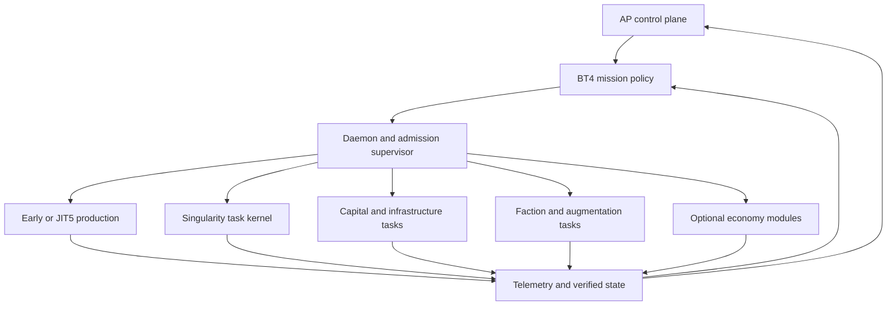

# Bitburner Engineering Checkpoint — 28 November 2026

> **Checkpoint ID:** `7N8-OPERATION-SINGULARITY-R3`
> **Date:** 06:40, 28 November 2026 (Asia/Jakarta)
> **Repository:** https://github.com/0x7n6/bitburner
> **Branch:** `main`
> **Verified remote HEAD at checkpoint preparation:** `f49f4c75de9d626cc9ec423bd01acab53a857935`
> **Runtime implementation baseline:** `29d802aa4d417d09cb2f2eed4b60930a10939bd7`
> **Previous checkpoint:** `checkpoint/26-11-26.md` (`OPERATION-SINGULARITY-R2`)
> **Agent protocol:** `helper/agent.md` (`7N8-AGENT-PROTOCOL-V1.0`)
> **Game:** Bitburner v3.0.1 (`3162fd2`)
> **Current mission:** Operation Singularity — complete BN4.1, BN4.2, BN4.3 and acquire SF4.3
> **Current BitNode:** BN4.1 — The Singularity
> **Owned Source-Files:** SF1.1; SF4.0 (Singularity available within BN4)
> **Production engine:** JIT5 γ3.6.1, standalone, single lane
> **Control plane:** AP V2
> **Next engineering milestone:** JIT5 γ3.7 hardening + BT4 α1 observation kernel, followed by lightweight Singularity progression
> **Scope:** Engineering continuity, empirical production benchmark, architectural diagnosis, progression strategy, and cross-BitNode autonomous lifecycle roadmap.

---

# 0. Mandatory resume protocol

This checkpoint supersedes the *current-state and forward-priority* sections of `checkpoint/26-11-26.md`. It does not replace historical engineering evidence or invalidate useful earlier decisions.

For a new assistant session:

```text
BB-RESUME
Repository: https://github.com/0x7n6/bitburner
Read helper/agent.md and follow its repository continuity protocol.
Inspect current Git HEAD, repository tree, active scripts/, latest checkpoint,
and relevant sources/. Verify version-matched official game mechanics.
Read checkpoint/28-11-26.md, especially sections 1, 10–19, 24–32 and 39–42.
Refresh actual runtime telemetry. Do not treat this snapshot as live state.
Continue the highest-priority unfinished task after identifying the current bottleneck.
```

If this file is no longer the latest checkpoint, read the newer one first. The agent must not assume access, tests, runtime state, or uncommitted local changes that it has not observed. Use guarded Python patchers for local terminal execution when appropriate. All new backups belong under `backups/`, not `backup/`. The operator handles staging, commits, and pushes unless explicitly requesting otherwise.

# 1. Executive summary

Operation Singularity has moved beyond emergency economic recovery. The early engine successfully recovered a nearly empty BN4 environment, but its sequential single-target wave architecture became demonstrably inefficient as the network expanded. JIT5 γ3.6.1 was then started manually on 64 GB of home RAM, without Formulas.exe, despite the daemon's provisional 128 GB automatic admission threshold. It successfully prepared `phantasy`, entered production, adapted to environmental changes, and continued through hundreds of epochs. Home RAM subsequently reached 128 GB, all five port openers were acquired, and Formulas.exe and DarkscapeNavigator.exe were purchased.

The latest supplied AP snapshot records $28.142 billion, hacking level 346, 128 GB home RAM, and JIT5 online. The best observed wall-clock epoch income in the detailed log is $1.35 million/s. This is not a whole-session average. No evidence establishes a sustained full-runtime average at that rate.

A detailed benchmark of epochs 276–346 exposes a recurring Grow launch failure cycle: 12 failed launches, all phase G on `phantasy`, amid 2,451 verified batches and no recorded drift. At epoch 327 the optimizer changes from approximately 4% to 3% take with a shorter batch period. The following 21 completed epochs (including epoch 347 from the screenshot) have no launch failures. This is a strong candidate stability profile, not a controlled causal experiment.

The mission bottleneck is changing from money acquisition toward hacking experience, faction reputation, installed augmentations, and eventually World Daemon readiness. The system must stop treating maximum local hacking income as the sole objective.

The strategic direction is to preserve JIT5 as the production engine, harden its admission/allocator/feedback interfaces, and develop BT4 as a lightweight mission controller using a shared task kernel. Do not build another competing daemon. Do not start JIT6 simply because BN4 is difficult. Do not assume BT4, automatic handoff, or full autopilot already exist.

# 2. Evidence and status conventions

- **IMPLEMENTED:** present in inspected repository source.
- **STATICALLY VALIDATED:** an actual typecheck or equivalent was reported successful for the relevant revision.
- **RUNTIME VALIDATED:** a specified scenario has been exercised in the game; this does not imply all scenarios pass.
- **OBSERVED:** directly present in operator-provided telemetry.
- **CONFIRMED DEFECT:** observed behavior and inspected source establish a concrete fault or invariant violation.
- **HYPOTHESIS:** plausible explanation awaiting diagnostic evidence.
- **PROPOSED / PENDING / DEFERRED:** design or work not yet implemented or validated.

Evidence sources: operator terminal transcripts and screenshots across the conversation; `Pasted markdown(10).md` containing epoch 276–346 summaries and the start of epoch 347; current repository inspection at the pinned HEAD; historical checkpoint R2; and version-matched official upstream source. The screenshot also shows the completion of epoch 347 and the plan for epoch 348. No new runtime script was written, deployed, or tested during preparation of this checkpoint.

# 3. Repository baseline and continuity

Remote inspection confirmed the following history:

| Commit    | Meaning                                                                                                      |
| --------- | ------------------------------------------------------------------------------------------------------------ |
| `29d802a` | Adaptive OS Part II-A: recovery engine, daemon policy, AP V2, FindV2, stopfarm changes                       |
| `6c3b4c5` | Operation Singularity R2 and community-driven roadmap                                                        |
| `13a0ed4` | Consolidated local backup policy and removed tracked historical backups from latest tree                     |
| `c23a563` | Published the 40-section Agent Continuity Protocol                                                           |
| `f49f4c7` | Latest observed HEAD, `adding features`; comparison against `c23a563` shows only `.github/FUNDING.yml` added |

The GitHub comparison confirms that no runtime changes occurred after the protocol commit through this HEAD. The latest checkpoint remotely available before creation of this document was `checkpoint/26-11-26.md` (4,729 lines as reported locally). `helper/agent.md` is now published, superseding the earlier checkpoint's pending-authorship note. Its filename does not itself guarantee automatic loading by an AI client; the project instructions or BB-RESUME request must direct the assistant to retrieve it.

Actual repository directories: `scripts/`, `sources/`, `checkpoint/`, `helper/`, `docs/`, `legacy/`, `.github/`. `backups/` is a local ignored recovery directory. `backup/` is deprecated and ignored defensively. Old backups remain in historical commits; no history rewrite is required. `README.md` remains minimal (`# bitburner`). The repository comparison is not a verification of the operator's current local working tree.

Selected source identities at the inspected HEAD (Git blob SHAs):

| File                  | Blob SHA                                   |
| --------------------- | ------------------------------------------ |
| `scripts/daemon.ts`   | `0d1900f61a49aa3165c8a17bf199a7a3c6b12686` |
| `scripts/early.ts`    | `e5da4c514c47b58ae3f2c441e0ea067f9cdd65fe` |
| `scripts/jit5.ts`     | `aa7ed84af7678f879118c63f07dc9e67743008a7` |
| `scripts/stopfarm.ts` | `8dd1913d8ee918083470057602bce5f08a44b5cf` |
| `scripts/ap.ts`       | `e0ba067b91ece2db0d658c6ebc70bcc59161d639` |

These are navigation and reproducibility anchors, not permanent version constraints. Inspect fresh source before any patch. This checkpoint is a targeted source review, not a complete repository-wide correctness audit.

# 4. Historical recovery milestones

BN1 was completed, unlocking SF1.1. Entering BN4 removed the mature BN1 economic environment and exposed major resource-admission deficiencies. Part I introduced cold boot recovery; Part II-A extended the early engine with target selection, BN8 XP mode, policy controls, AP V2, and hardened lifecycle/navigation behavior. The previous checkpoint contains details of those patches, typechecks, early runtime tests, and the community research corpus.

| Milestone                 |  Hacking |                   Money | Home RAM |                      Openers | Engine    |
| ------------------------- | -------: | ----------------------: | -------: | ---------------------------: | --------- |
| BN4 entry                 |        1 |                 $1.262k |    32 GB |                          0/5 | Cold boot |
| Part II-A recovery        |       12 |                $21.339k |    32 GB |                          0/5 | Early     |
| Early late recovery       |  195–197 |                 $26–27m |    32 GB |                          3/5 | Early     |
| Manual JIT5 startup       | ~199–205 | Changing with purchases |    64 GB |                        3→4/5 | JIT5      |
| JIT5 expansion            |      223 |               $358.655m |   128 GB |                          4/5 | JIT5      |
| SQLInject acquisition era |      227 |               $230.345m |   128 GB | 5/5 (subsequently confirmed) | JIT5      |
| Epoch 17 era              |      245 |               $951.843m |   128 GB |                          5/5 | JIT5      |
| Latest AP                 |      346 |                $28.142b |   128 GB |                          5/5 | JIT5      |

Snapshots are historical and not simultaneous. Balance changes include purchases and potentially other income (crime, etc.); they must not be attributed entirely to hacking. Network observations are also historical: 8/70 rooted with 132 GB total RAM early in recovery; 28/70 and 1.11 TB at hacking 197. A prior assistant response reported 33 workers and 1.50 TB after SQLInject, but the exact worker-capacity header is not visible in the supplied target-ranking screenshot. Treat those latter figures as provisional until refreshed from `target.ts --workers --no-root` or equivalent telemetry.

# 5. Latest player and runtime snapshot

Latest operator-provided AP and terminal output:

```text
Game        : Bitburner v3.0.1 (3162fd2)
BitNode     : 4 (first completion cycle)
SF1         : 1/3
SF4         : 0/3
Singularity : YES
Policy      : AUTO
OS          : UNPAUSED
Hack        : 346
Money       : $28.142b
Home        : 25.80 / 128.00 GB (while AP is running)
Free RAM    : 102.20 GB (while AP is running)
CPU         : 1
Openers     : 5/5
Formulas    : YES
Engine      : jit5.ts
Daemon      : OFFLINE
Progression : OFFLINE
Share       : OFFLINE
Trader      : OFFLINE
```

After AP exits, `free` reports 18.45 GB used and 109.55 GB available. Screenshot near the AP measurement showed $28.126b, 22/22 HP, strength 120, defense 120, dexterity 121, agility 121, charisma 120, and a manual Heist in progress. The screenshot's Heist percentage is activity progress, not success probability. Do not assume any particular action ownership policy is implemented. `AUTO` here is the engine-policy marker; it is not evidence that daemon or mission automation is active.

JIT5 has historically been running with PID 146, standalone. The latest snapshot confirms the engine filename but does not independently re-establish PID 146. The last observed configuration was:

```text
jit5.ts --targets 1 --reserve-pct 0.25 --take-min 0.02 --take-max 0.1
```

All five port openers, ServerProfiler.exe, DeepscanV1.exe, DeepscanV2.exe, AutoLink.exe, DarkscapeNavigator.exe, and Formulas.exe are owned. TOR access is strongly indicated by the purchase history, but current TOR state should be verified before an automated purchase decision. Installed/queued augmentation counts, faction membership, reputation, favor, current target inventory, contract inventory, cloud fleet, and current money-source breakdown are not supplied in the latest snapshot.

# 6. BN4 economic constraints and design implications

Official game source at `3162fd2` sets these relevant BN4 multipliers:

| Mechanic                                                    | Multiplier |
| ----------------------------------------------------------- | ---------: |
| Server maximum money                                        |     0.1125 |
| Server starting money                                       |       0.75 |
| ScriptHackMoney                                             |        0.2 |
| Company work money                                          |        0.1 |
| Crime money                                                 |        0.2 |
| Hacknet node money                                          |       0.05 |
| Hacking experience                                          |        0.4 |
| Class/gym, company, crime and faction work experience       |        0.5 |
| Faction work reputation                                     |       0.75 |
| Darknet money                                               |        0.4 |
| CloudServerSoftcap                                          |        1.2 |
| WorldDaemonDifficulty                                       |          3 |
| Coding contract money (default, not overridden)             |          1 |
| Infiltration money and reputation (default, not overridden) |          1 |

Do not confuse `ScriptHackMoney` with a direct universal payout multiplier. It affects per-thread stolen fraction. Combining 0.1125 and 0.2 gives an illustrative 0.0225 relative to baseline for otherwise identical fixed-thread conditions, not a guaranteed 44.4× reduction in every actual income scenario. Once the stolen fraction is held fixed, the comparison changes. Actual growth, timing, success probability, skill, augmentations, and worker capacity matter.

The correct response is not to remove intended game restrictions. It is to optimize within them: high-value targets, RAM-second efficiency, effective concurrency, lower recovery overhead, diversified economic options, and earlier capability acquisition. BN4 is a resource-constrained engineering environment, not proof that all other BitNodes will be easier.

# 7. Early V1: successful recovery, unsuitable mature scheduler

The early engine was intentionally simple: select one target, run a wave of H/G/W workers across rooted remote hosts, wait for that wave, then reassess. Default take is 10%. It provides a low-RAM, non-Formulas fallback and preserves a recovery path in poor environments.

At hacking 197, the operator supplied actual `foodnstuff` waves:

| Phase             | Launched / capacity | Thread utilization |
| ----------------- | ------------------: | -----------------: |
| Hack              |           106 / 632 |              16.8% |
| Weaken after hack |             5 / 622 |               0.8% |
| Grow              |           622 / 622 |               100% |
| Weaken after grow |            50 / 622 |               8.0% |

A later grow used 614/622 threads and weaken used 42/622. These are individual wave snapshots, not time-weighted mean RAM utilization. The observed engine behavior confirms severe idle capacity during specific phases. The basic target score omits full HGW cycle RAM-second demand, preparation cost, distributed capacity and parallel target opportunities.

Early V1 has fulfilled its original mission. Preserve it as a robust fallback. An Early V2 intermediate swarm was discussed, but is now DEFERRED because JIT5 already demonstrated productive startup at 64 GB and viable ongoing production. Revisit only if capability-based admission experiments identify a real recovery gap between Early and JIT5.

# 8. Target analysis and selection

At hacking 197, the no-Formulas `target.ts --hackable --top 15` analysis reported the following projected economics for a 10% take:

| Target         | Max money | Projected $/GB/s | State |
| -------------- | --------: | ---------------: | ----- |
| phantasy       |    $67.5m |            61.26 | PREP  |
| max-hardware   |    $28.1m |            46.64 | PREP  |
| harakiri-sushi |    $11.3m |            42.77 | PREP  |
| joesguns       |     $7.0m |            35.74 | PREP  |
| nectar-net     |     $7.7m |            31.33 | PREP  |
| foodnstuff     |     $5.6m |            13.53 | PREP  |
| n00dles        |   $196.9k |             2.96 | PREP  |

`phantasy` had approximately 4.53× the projected efficiency of `foodnstuff`, but required preparation (26.7% cash and security delta 13). At hacking 227, `phantasy` remained first with $79.32/GB/s, 100% cash, zero security delta, 80.7% hack chance, 35 s hack time, and no preparation requirement. `max-hardware` was second ($57.24/GB/s); `omega-net` had larger max money ($194.3m) but much lower projected efficiency ($15.10/GB/s).

The analyzer's score is expected money divided by HWGW RAM and prepped weaken time. Before Formulas acquisition, prepped economics were estimates. These scores are neither measured income nor a guarantee that the highest-scoring target is globally optimal. Recompute with Formulas and actual resource placement. Do not hardcode `phantasy` as the permanent production target; it is the empirically successful target for this phase.

# 9. JIT5 manual admission experiment

The daemon's provisional cold boot policy in the current source includes `homeRam < 128`, `hack < 50`, forced early policy, and BN8. If Early is already running, the daemon deliberately retains it; an automatic handoff is not implemented.

The operator upgraded home to 64 GB, manually killed daemon PID 1 and Early PID 2, confirmed home `ps` was empty, and ran:

```text
run jit5.ts --dry-run --targets 1 --reserve-pct 0.25 --take-min 0.02 --take-max 0.10
run jit5.ts --targets 1 --reserve-pct 0.25 --take-min 0.02 --take-max 0.10 --tail
```

This is a record of what happened, not the recommended generic shutdown procedure. Killing controllers manually does not prove that distributed Early workers have drained. Future transitions must use managed pause/drain and check the entire network. The dry-run also has known side effects (auto-root and telemetry port clear); it must not be treated as a pure probe while another engine is active.

| Planner / execution           |  Take |   Period | Predicted income |
| ----------------------------- | ----: | -------: | ---------------: |
| Dry run, phantasy             | 3.00% | 49.658 s |         $31.4k/s |
| Production epoch 1 after prep | 3.99% | 15.673 s |        $132.9k/s |

Two harvest controllers were launched for the same target (see section 12). Both reported READY and production began. This establishes that 128 GB is not a necessary hardware threshold for standalone JIT5 startup in the observed environment. It does not establish safe integrated operation at 64 GB, universal startup feasibility, or production at 32 GB. The correct future gate is capability/resource based, including preparation RAM, emergency reserve, worker placement and economic feasibility.

# 10. Early JIT5 production benchmark (epochs 1–17)

The initial experiment was conducted without Formulas.exe. Hacking skill, home RAM and opener access changed during the session. The following data are operator-reported epoch metrics, not normalized benchmarks across identical environments.

| Epoch | Predicted $/s | Wall $/s | Verified | End reason / notes                                                                |
| ----: | ------------: | -------: | -------: | --------------------------------------------------------------------------------- |
|     1 |        132.9k |   102.9k |       32 | ENVIRONMENT; zero drift/launch failures; p95 jitter 7.1 ms                        |
|     2 |        178.9k |        0 |        0 | LAUNCH H                                                                          |
|     3 |        173.9k |        0 |        0 | LAUNCH H                                                                          |
|     4 |        169.2k |        0 |        0 | LAUNCH H                                                                          |
|     5 |        164.8k |   114.3k |       18 | DRIFT-PERSIST; money 93.79%, security delta 0, p95 jitter 382.4 ms, late 573.5 ms |
|     6 |        166.2k |   136.2k |       24 | ENVIRONMENT; no launch failure/drift                                              |
|     7 |        172.9k |   134.6k |       40 | WINDOW; jitter 239.4 ms, late 274.7 ms                                            |
|     8 |        175.0k |   176.6k |       40 | WINDOW; jitter 8.4 ms, zero late/drift/launch failure                             |
|     9 |        182.8k |   187.6k |       12 | LAUNCH H; jitter 7.4 ms                                                           |
|    10 |        181.7k |   159.2k |       36 | ENVIRONMENT                                                                       |
|    11 |        583.3k |   328.4k |       40 | WINDOW                                                                            |
|    12 |        607.6k |   533.7k |       40 | WINDOW                                                                            |
|    13 |        626.5k |   618.0k |       40 | WINDOW; healthy                                                                   |
|    14 |        653.3k |   685.8k |       11 | DRIFT-PERSIST; money 95.82%, security delta 0; late 511.8 ms                      |
|    15 |        646.3k |   367.8k |       40 | WINDOW; actual production $651k/s, suspected recovery/warm-up overhead            |
|    16 |        671.6k |   607.5k |       40 | WINDOW; no drift or launch failure                                                |
|    17 |        699.5k |  Unknown |  Unknown | Plan only in this transcript                                                      |

After SQLInject acquisition and environment replan at the end of epoch 10, throughput increased substantially. Opener acquisition, skill growth, and planner changes co-occurred, so do not attribute the entire improvement to the opener alone. The batch period fell from 15.673 s at epoch 1 to 3.207 s in the epoch 17 plan, a 4.89× increase in admission frequency. Take remained close to 4% (3.99→4.02%). This illustrates the economic importance of cadence rather than simply stealing a larger fraction per batch.

No completed-epoch record is available in the supplied evidence for epochs 17–275. Do not invent results for this interval.

# 11. Long-running production benchmark (epochs 276–347)

Statistics were recomputed from the original operator-provided Markdown log using a line parser matching completed `[EPOCH n]` summaries. Scope is epochs 276–346 inclusive. The screenshot separately supplies epoch 347 completion. Epoch 348 is a plan only.

| Statistic                   |    E276–346 |    E276–326 | E327–346 |
| --------------------------- | ----------: | ----------: | -------: |
| Completed epochs            |          71 |          51 |       20 |
| Verified batches            |       2,451 |       1,651 |      800 |
| Launch failures             |          12 |          12 |        0 |
| Epochs with launch failure  | 12 (16.90%) | 12 (23.53%) |        0 |
| Recorded drift events       |           0 |           0 |        0 |
| Median epoch wall rate      |    $1.15m/s |    $1.10m/s | $1.22m/s |
| Maximum reported wall rate  |    $1.35m/s |    $1.27m/s | $1.35m/s |
| Maximum reported PID metric |         394 |         277 |      394 |

The median is unweighted across epoch summaries. It is not total hacking revenue divided by total elapsed wall-clock time. The log does not include complete epoch elapsed durations or all historical epochs, so a session-wide time-weighted mean cannot be established. The PID metric is the reported engine metric, not necessarily the simultaneous count of all game processes.

All 12 launch failures occur in phase G, `LAUNCH phantasy G REMOTE_ALL`, at epochs:

```text
277, 282, 287, 292, 297, 301, 305, 309, 313, 317, 321, 325
```

Each early group of failures is followed by a low wall-rate recovery window, generally around $0.46–0.56m/s, despite an actual production rate near $1.0–1.25m/s. Repeated overclock/backoff cycles are visible. The exact causes of lost wall time need phase-duration telemetry.

## 11.1 Candidate champion transition

| Parameter         | E326 plan (4% family) | E327 plan (3% family) | E348 plan |
| ----------------- | --------------------: | --------------------: | --------: |
| Take              |                 4.03% |                 3.01% |     3.02% |
| H/G/W1/W2 threads |             63/30/3/3 |             47/23/2/2 | 47/23/2/2 |
| Gap               |                 60 ms |                 50 ms |     50 ms |
| Period            |              2,038 ms |              1,488 ms |  1,488 ms |
| Predicted         |              $1.20m/s |              $1.23m/s |  $1.23m/s |

At epoch 327, JIT5 moves to smaller batches and more frequent admission. From 327 through 347, 21 completed epochs have 40 verified batches each (840 total), zero launch failures, and zero drift reported. Several of these still have low wall rates or timing pressure. The final screenshot shows epoch 347: wall $1.20m/s, 40 verified, p95 jitter 9.6 ms, late 0, drift 0, launch failure 0, reported PIDs 326. Epoch 348 has a predicted $1.23m/s and is not completed in the evidence.

The 3% family is a *candidate champion*, not a proven optimal policy. Hacking skill, environment, safety margin, lead, period, and worker distribution are changing. Do not force a universal fixed 3% take. The engine has a learned ceiling of 10% while the active take cap is 4%; those are different controls. Record both, along with actual take and requested take.

## 11.2 Economic milestone

Best observed epoch wall rate rises from $102.9k/s (E1) to $1.35m/s (E339 and E340), approximately 13.1×. E339 and E340 have no drift/launch failure but do show timing-pressure backoff. The milestone is evidence of productive operation in BN4, not proof of optimal or stable lifetime production. Formulas was absent at startup and is owned at the latest snapshot; its precise purchase epoch and isolated effect are not established by the supplied logs.

# 12. Confirmed defect: duplicate preparation ownership

Startup log:

```text
[PREWARM] phantasy started in background | PID 147
[BOOT] no READY production target; performing one bootstrap prep.
PID 147 harvest.ts phantasy --prep-only --no-home
PID 148 harvest.ts phantasy --prep-only --reserve 16
```

Both controllers reported READY. Current JIT5 source has `startBackgroundPrep()` and `prepTarget()` paths. The background path checks for duplicate prep, but the blocking bootstrap path can independently launch another `harvest.ts` for the same target. Each costs 13.80 GB, so redundant controllers consume 27.60 GB at startup before workers.

**Proposed fix:** single-flight preparation ownership keyed by target and owner generation. Bootstrap must adopt/wait for an existing compatible prep rather than start another; production cannot start until target readiness and outstanding conflicting prep are reconciled. Ensure bounded timeout, pause handling, process disappearance, failure cleanup and fallback. Do not kill unrelated/manual harvest work blindly. Test both cold start and background prewarm, including an occupied target and low RAM.

# 13. Planner–allocator mismatch and Grow launch failures

Current source inspection identifies average weighted RAM occupancy as an important planner estimate, while `launchDistributed()` allocates discrete threads against actual available host RAM at launch time. If it cannot allocate all remaining threads, it kills already-launched PIDs from that phase and returns an empty allocation. The failure path can abort the tracked runtime pipeline.

Average occupancy is necessary but not sufficient for placement feasibility. A pipeline with acceptable RAM-seconds can still violate instantaneous aggregate capacity, per-host capacity, reserve rules, or integer thread placement. A script may also fail to launch for reasons other than RAM.

The 12 repeated G launch failures and earlier H launch failures are observed. Peak occupancy/fragmentation is the leading hypothesis, NOT yet a confirmed exact cause. No per-host free-RAM, remaining-thread or `exec` failure reason snapshot was captured at those events. PID values are far below the historical governor limits (8,000/9,500); do not raise them as a remedy.

### Required diagnostic contract (PROPOSED)

Capture a bounded failure record, not verbose every-tick logging:

- Epoch, lane, batch ID, phase, target, topology, launch and deadline timestamps.
- Requested, placed, remaining and rolled-back threads; per-thread RAM; worker file presence.
- Eligible host count, total available RAM, integer thread capacity, and relevant per-host free/reserved RAM.
- Active controller/worker reservations, outstanding phases and expected release times.
- `ns.exec` result and classified reason where the API and observed state allow a reliable classification; use UNKNOWN otherwise.
- Requested/actual take, gap, cadence, lead, safety, PID estimate and observed PID metric.
- Cleanup outcome, target readiness, time to recovery, and next policy action.

Avoid claiming an exact `exec` error reason from a zero PID alone. Use actual evidence and bounded diagnostics. Keep telemetry RAM and runtime overhead low enough not to change the failure being measured.

# 14. Timing drift and adaptive oscillation

Earlier epochs demonstrate separate timing and resource problems: E5 jitter 382.4 ms / late 573.5 ms / money 93.79%; E14 jitter 8.5 ms / late 511.8 ms / money 95.82%. Security delta was zero in both. In the long log, all completed epochs record zero drift, yet launch lateness can spike (E344 374.6 ms) and trigger backoff. Completion jitter and dispatch lateness are distinct measurements.

The observed 4% family frequently approaches a tight capacity margin, fails, backs off, and later overclocks toward similar conditions. This is consistent with adaptive oscillation. The control system recovers but does not reliably avoid returning to failed regions. The 3% family suggests a better frontier may be available without sacrificing theoretical income.

Proposed failure-specific responses:

| Failure class                    | Candidate response                                                                                                         |
| -------------------------------- | -------------------------------------------------------------------------------------------------------------------------- |
| Capacity/placement shortfall     | Increase period floor or reduce resource demand; replan placement; keep timing settings unless timing evidence also exists |
| Missing/failed worker deployment | Reconcile deployment and eligibility before retry                                                                          |
| Dispatch lateness                | Adjust lead and dispatch budget; investigate event-loop delay                                                              |
| Completion jitter/order risk     | Adjust completion gap and timing guard                                                                                     |
| Money drift                      | Validate grow compensation, completion order and cadence                                                                   |
| Security drift                   | Validate weaken allocation and core effects                                                                                |
| PID pressure                     | Limit concurrency/host splitting when actual evidence warrants                                                             |
| Unknown                          | Conservative bounded recovery and telemetry, not speculative overclock                                                     |

Introduce hysteresis and a failure memory keyed by target, topology, environment and configuration. A stable profile should earn promotion using recovery-inclusive economics over multiple comparable windows. Use cooldowns and bounded probes; never let a failed probe permanently stop recovery production. Avoid unbounded state or overly granular keys that prevent learning. Root causes of OS/runtime jitter remain unverified.

# 15. Economics: wall-clock over ideal throughput

The mature objective is to maximize reliable mission-relevant output per elapsed wall-clock time. Local production objective:

```text
maximize E[useful revenue] / E[production time + recovery time + preparation overhead]
subject to RAM placement, deadline, stability, reserve and ownership constraints
```

`pred` is model output. `actual`, `wall`, and `realized` are engine-specific metrics; inspect `printMetrics()` and its upstream accumulators before using them as external accounting identities. Do not multiply `pred` by elapsed hours and call it observed income. Do not average per-epoch rates without weighting when epochs have unequal durations. Add epoch elapsed duration, actual script income deltas and phase durations for reproducible aggregation.

A stable $1.15m/s would produce $4.14b/hour, but this is an illustration using the unweighted epoch median as a constant scenario, not the actual measured hourly income. The latest $28.142b balance includes purchases and potentially crime income. Resource-expansion feedback is valuable, but reserve funds for capability acquisition and augmentation cycles.

# 16. RAM accounting and control-plane headroom

Measured RAM costs from operator `mem` and prior checkpoint:

| Script         |    GB | Evidence                                     |
| -------------- | ----: | -------------------------------------------- |
| daemon.ts      |  6.50 | Historical measured                          |
| early.ts       |  9.95 | Historical measured                          |
| jit5.ts        | 18.45 | Measured in this conversation                |
| harvest.ts     | 13.80 | Measured in this conversation                |
| stopfarm.ts    |  4.50 | Measured in this conversation                |
| ap.ts          |  7.35 | Measured via AP occupancy / prior checkpoint |
| target.ts      | 11.80 | Measured in this conversation                |
| progression.ts | 11.10 | Historical measured                          |
| share.ts       |  4.10 | Historical measured                          |

At 32 GB, daemon + JIT5 = 24.95 GB, leaving only 7.05 GB (less than one harvest controller). At 64 GB, the same pair leaves 39.05 GB. At 128 GB, daemon + JIT5 + AP + one harvest + 4.50 GB emergency-stop reserve totals 50.60 GB, leaving a theoretical 77.40 GB before other work. These are static sums; worker placement, temporary tasks, reserve behavior and actual concurrent availability must be measured. `REMOTE_ALL` is a topology label; the 64 GB test showed home J5 workers too, so do not assume the topology excludes home unconditionally.

At latest snapshot, actual home use was only JIT5's 18.45 GB outside AP. Daemon, progression, share and trader are offline. The goal is to retain enough headroom for the control plane and emergency commands under load, not maximize home utilization indiscriminately.

# 17. Current implementation strengths

- Early recovery works with limited resources and without Formulas.
- JIT5 supports non-Formulas planning, target preparation, continuous HWGW, adaptive cadence and measured economic feedback.
- JIT5 can discover roots and replan on environment changes independently of daemon.
- Runtime evidence demonstrates startup at 64 GB, hundreds of epochs, recovery from failures, and million-dollar-per-second peak windows in BN4.
- AP V2 provides a unified interface and reports engine and service status.
- Existing `target.ts` offers a more complete economic comparison than Early's initial score.
- Existing trader subsystem, progression/backdoor tool, fleet tooling and share service provide reusable foundations.
- Git history, guarded patching, local backups and the agent protocol make incremental development reproducible.

These strengths do not establish full autonomous gameplay. The operator still performed purchases, upgrades, engine switching and player work manually.

# 18. Current limitations and debt register

| ID     | Finding                                                                                | Status                 | Priority |
| ------ | -------------------------------------------------------------------------------------- | ---------------------- | -------- |
| JIT-01 | Duplicate preparation controllers for same target                                      | CONFIRMED DEFECT       | P0       |
| JIT-02 | Repeated H/G launch failures; exact allocation cause unknown                           | OBSERVED / HYPOTHESIS  | P0       |
| JIT-03 | Average occupancy insufficient to establish peak placement feasibility                 | DESIGN LIMITATION      | P0       |
| JIT-04 | Backoff can revisit failed operating regions; failure classes insufficiently separated | OBSERVED / PROPOSED    | P0       |
| JIT-05 | Dry-run clears port and auto-roots                                                     | CONFIRMED SIDE EFFECT  | P0       |
| JIT-06 | No complete recovery-inclusive phase-duration accounting in supplied telemetry         | PENDING                | P1       |
| OS-01  | Fixed 128 GB/50 hack admission thresholds; no automatic handoff                        | IMPLEMENTED LIMITATION | P0       |
| OS-02  | Standalone JIT5 is not supervised; integrated lifecycle not validated at latest RAM    | PENDING                | P0       |
| OS-03  | Cross-engine ownership/drain and orphan worker reconciliation incomplete               | PENDING                | P0       |
| OS-04  | Emergency RAM reserve not globally enforced across all services                        | PENDING                | P0       |
| OS-05  | Share-specific shutdown regression not yet revalidated                                 | PENDING                | P1       |
| AP-01  | AP V2 control surface exists; mission decisions/status not implemented                 | PENDING                | P1       |
| AP-02  | Some FindV2/manual/universal-launcher regression cases remain untested                 | PENDING                | P1       |
| BT-01  | Mission observation and bottleneck ranking absent                                      | PROPOSED               | P0       |
| BT-02  | Shared player action ownership and Singularity task kernel absent                      | PROPOSED               | P0       |
| BT-03  | Coordinated capital manager absent                                                     | PROPOSED               | P0       |
| BT-04  | Automatic faction/augmentation/reset/BitNode lifecycle absent                          | PROPOSED               | P0       |
| ECO-01 | Coding contracts, Darknet economy, pre-4S trader integration not validated             | PENDING                | P1/P2    |

Do not treat this as a claim that every other function in the repository is correct. The latest runtime stress test exposed defects that were hidden by abundant BN1 resources.

# 19. Decision: preserve JIT5; defer Early V2 and JIT6

The previous roadmap considered an intermediate adaptive swarm engine between Early and JIT5. The 64 GB startup experiment removes the immediate need to build one. Preserve Early's simplicity and improve JIT5's resource-aware admission instead. If later testing demonstrates an unresolved resource gap, reconsider a minimal intermediate path based on evidence.

JIT6 remains the future scheduling frontier: explicit global reservation calendar, peak occupancy and integer placement across hosts, deadline-aware scheduling, multi-lane portfolios, failure isolation, global opportunity cost and controlled learning. Some of those principles can be introduced incrementally into JIT5 γ3.7 without a complete rewrite. Do not duplicate daemon, control plane, and mission strategy inside the production scheduler.

---

# 20. Operation Singularity: completion requirements

The mission remains BN4.1 → BN4.2 → BN4.3 → SF4.3. The first three successful completions of BN4 grant/upgrade the Source-File. While inside BN4, Singularity is already available. Outside BN4, SF4.1 gives permanent access at 16× Singularity API RAM cost, SF4.2 reduces it to 4×, and SF4.3 reduces it to normal 1×. These multipliers concern Singularity function costs, not every instruction in a script. The same API capabilities are available at SF4.1; additional levels principally reduce cost.

Verified official Daedalus invitation logic at game commit `3162fd2`:

```text
Installed augmentations >= 30 (BN4 default requirement)
Money >= $100 billion
AND (hacking >= 2500 OR all combat skills >= 1500)
```

The faction uses a delayed augmentation condition; exact invitation timing must be observed. The condition counts installed augmentations, not the queued set. Do not assume NeuroFlux purchases substitute for distinct installed augmentations; use the actual installed count and official condition. Joining requires faction invitation and subsequent membership. The standard route then obtains The Red Pill through the relevant requirements, installs it, and gains access to the World Daemon.

**Important additional completion constraint:** BN4 sets `WorldDaemonDifficulty = 3`. Official server metadata has a base required hacking skill of 3,000 and five ports; `ServerHelpers.ts` multiplies the requirement by the node multiplier. The nominal BN4 World Daemon hacking requirement is therefore **9,000**, not the 2,500 Daedalus invitation threshold. Verify the live target requirement once it is accessible. Do not backdoor/destroy it in generic navigation or auto-root flows. The final transition requires explicit operator authorization or a separately authorized completion policy.

The Darknet labyrinth and alternative Red Pill mechanics merit dedicated version-specific investigation, but do not assume a Darknet reward path replaces the standard Daedalus route in this mission without validating the actual game rules and prerequisites.

# 21. How close are we to BN4.1 completion?

| Readiness dimension              | Latest observed |                   Threshold | Assessment                 |
| -------------------------------- | --------------: | --------------------------: | -------------------------- |
| Permanent SF4                    |               0 |                    3 levels | Mission incomplete         |
| Port openers                     |               5 |                           5 | Complete for current reset |
| Formulas                         |           Owned |            Optional, useful | Complete for current reset |
| DarkscapeNavigator               |           Owned |                    Optional | Available for research     |
| Daedalus liquid money            |        $28.142b |                       $100b | 28.142%; deficit $71.858b  |
| Daedalus hacking route           |             346 |                       2,500 | 13.84% of skill threshold  |
| Daedalus combat route            | 120/120/121/121 |                  1,500 each | Far from threshold         |
| Installed augmentations          |         Unknown |                          30 | Refresh immediately        |
| Daedalus membership / reputation |         Unknown |           Live requirements | Refresh immediately        |
| The Red Pill ownership/install   |         Unknown | Required for standard route | Refresh immediately        |
| World Daemon hacking             |             346 |        9,000 nominal in BN4 | 3.84% of skill threshold   |
| Completion authorization         |  Not configured |                    Explicit | Pending                    |

These percentages are separate readiness indicators, not an overall percentage of BitNode completion. Skill level progression is nonlinear; 13.84% of the level threshold is not 13.84% of time or XP. At constant $1.15m/s with no spending or downtime, the $71.858b gap would take approximately 17.36 hours. This illustrative scenario is NOT an ETA for Daedalus or BitNode completion. Augmentation purchases, resets, changing production, skill requirements and reputation change the trajectory substantially.

The strongest remaining bottleneck appears to be player progression rather than basic capital recovery. The exact bottleneck depends on installed augmentations, faction availability, multipliers and the live progression state, which are not yet supplied. Do not let the system accumulate billions indefinitely while ignoring hacking experience and reputation.

# 22. Progression strategy: capability acquisition over idle farming

Use the current production engine to fund progression and invest in capabilities that reduce time to mission completion. Immediate priorities:

1. Observe installed and queued augmentations, invitations, membership, city, player work, faction reputation/favor, available augmentation prerequisites and prices, hacking multipliers and experience.
2. Inspect reachable hacker factions and backdoor requirements (CyberSec, NiteSec, The Black Hand, BitRunners), and appropriate city/early factions. Join selectively; city faction conflicts and prerequisites matter. Do not hardcode membership based on skill alone.
3. Rank augmentations by contribution to hacking XP, hacking skill, speed, chance, growth, money and faction reputation, plus prerequisite paths and reset economics. Distinguish capability boosts from the installed-count requirement.
4. Compare player action candidates: faction work, study, crime, company work and program creation. The operator's current manual Heist must not be interrupted without explicit policy authorization.
5. Plan augmentation cycles with meaningful install timing, preserve reset funding where applicable, and re-bootstrap after authorized installs. Do not wait for all possible augmentations before a beneficial reset; do not reset so frequently that early recovery dominates total time.
6. Move toward Daedalus invitation, The Red Pill and World Daemon readiness while monitoring actual skill/XP rates and current completion requirements.

Hacking route is the natural working hypothesis because the OS already generates hacking experience and economy. Combat route remains an alternative to evaluate rather than an automatic choice. Increasing skill and productive multipliers can benefit subsequent cycles dramatically; do not claim a completion time until actual XP and rep accumulation are measured.

# 23. Capital strategy at $28.142b

Capital is a shared resource. Do not independently let trader, fleet, augmentation and infrastructure scripts spend the same money. Use a coordinated reserve and transaction ownership policy.

Candidate investments:

| Item                                 | Policy                                                                                                    |
| ------------------------------------ | --------------------------------------------------------------------------------------------------------- |
| Home RAM 256–512 GB                  | Consider as needed for persistent/temporary task admission and worker capacity; no longer an emergency    |
| Cloud fleet                          | Evaluate marginal usable threads and measured payback; compare with buying augmentations                  |
| Home cores                           | Evaluate actual local grow/weaken benefit, topology and alternative investments                           |
| Hacking and reputation augmentations | High mission priority; use live availability and cost                                                     |
| Coding contracts                     | Research bounded solver with attempt safeguards; reward multiplier not nerfed directly in BN4             |
| Stock market                         | Existing trader requires capability/capital checks; no automatic speculative depletion of mission reserve |
| Darknet                              | Program acquired; investigate in bounded research tasks; BN4 money multiplier 0.4                         |
| Hacknet Nodes                        | Poor direct money multiplier in BN4; invest only for a demonstrated capability/mission benefit            |
| Infiltration                         | Manual supplemental income or faction rep; not assumed to have a supported full automation API            |

Official home upgrade formula is `currentRam * 32000 * 1.58**log2(currentRam) * HomeComputerRamCost`. Earlier estimates: 32→64 about $10.08m, 64→128 about $31.86m, 128→256 about $100.67m, 256→512 about $318.12m. Use `getUpgradeHomeRamCost()` for the actual purchase quote; historic rounded costs are not spending authorization.

A capital manager should maintain a protected reserve for reset/augmentation/mission needs, recheck balances and cost immediately before execution, serialize conflicting spending, bound per-action budgets, and record marginal benefits. Avoid rigid purchase order after every reset: the next best investment depends on capability and mission state. Buying infrastructure solely because it is affordable is not an optimization strategy.

---

# 24. Architectural direction: BT4 is a mission controller

The operator proposed a `bt4.ts` system capable of surviving and progressing under the severe BN4 restrictions, then bringing the resulting capabilities into other BitNodes. This is the central new architectural decision of this checkpoint.

BT4 should be a mission-oriented policy layer, not a second hacking engine and not a competing daemon. It decides what outcome is valuable; the supervisor determines what can be admitted and executed; specialized tasks implement bounded actions; the production engine handles hacking scheduling. This separation allows the same scheduler and services to be reused with different missions.



| Component                    | Responsibility                                                 | State                                                      |
| ---------------------------- | -------------------------------------------------------------- | ---------------------------------------------------------- |
| `ap.ts`                      | Operator interface and lifecycle controls                      | IMPLEMENTED, mission expansion pending                     |
| `bootstrap.ts`               | Restore basic OS after authorized reset                        | IMPLEMENTED foundation, reset lifecycle not validated here |
| `daemon.ts`                  | Resource supervision, service ownership, lifecycle arbitration | IMPLEMENTED foundation; admission improvements pending     |
| `early.ts`                   | Minimum-resource recovery and XP fallback                      | IMPLEMENTED                                                |
| `jit5.ts`                    | Adaptive HWGW production                                       | IMPLEMENTED / observed                                     |
| `bt4.ts`                     | BN4 mission observation, decisions and policy                  | PROPOSED, file does not exist at inspected HEAD            |
| Singularity task kernel      | Bounded capability-gated actions                               | PROPOSED                                                   |
| Capital manager              | Coordinated budgets, investments, protected reserves           | PROPOSED                                                   |
| Faction/augmentation manager | Progression and reset plans                                    | PROPOSED                                                   |
| Universal mission controller | Shared policy framework across nodes                           | FUTURE                                                     |

No new permanent controller should be introduced solely to run a periodic check. In minimal environments BT4 may be a short-lived planning task invoked by daemon rather than a persistent resident process. Select the implementation after measuring static RAM and scheduler integration cost. Avoid importing all expensive APIs into a persistent controller. API isolation reduces resident RAM occupancy; it does not make those APIs free.

# 25. Proposed module boundaries

The following layout is a design proposal, not the current Git tree. It should be implemented incrementally and checked against actual file-sync behavior and Netscript module resolution. Flat filenames may be preferable for the first implementation to avoid an unnecessary directory migration.

```text
scripts/
  ap.ts
  bootstrap.ts
  daemon.ts
  early.ts
  jit5.ts
  bt4.ts                   # mission policy and observation interface
  core/                    # optional shared pure logic
    capability.ts
    admission.ts
    ownership.ts
    telemetry.ts
    state.ts
  policy/
    universal.ts
    bn4.ts
    capital.ts
  tasks/                   # bounded runtime entrypoints, as needed
    observe-player.ts
    study.ts
    crime.ts
    programs.ts
    upgrade-home.ts
    contracts.ts
    factions.ts
    augment.ts
    ascend.ts
  engine/
    admission.ts
    handoff.ts
    planner.ts
    health.ts
```

Names, interfaces and version numbers are provisional. Do not create empty placeholder files or move mature scripts merely to match this tree. Preserve compatibility with the existing AP and aliases. Prefer small testable contracts over monolithic service imports.

# 26. BT4 α1 — observation kernel and mission dashboard

First BT4 implementation must be read-only and capability-aware. Its initial goal is to make progression bottlenecks visible without spending money, changing player work, rooting servers, starting workers, clearing active ports or installing augmentations.

Observe, as available:

- Current BitNode, owned Source-Files, reset identity and relevant capability flags.
- Player money, hacking/combat skill, XP and multipliers; city and current work.
- Home RAM, CPU cores, free RAM and emergency reserve requirements.
- Rooted servers, worker capacity, opener inventory and Formulas availability.
- Production engine identity, arguments, mode, health and available telemetry.
- Current faction membership, invitations, reputation, favor, installed and queued augmentations, and accessible augmentation prerequisites.
- Daedalus threshold and World Daemon readiness when observable.
- Pending actions, protected capital, available economic modules, and missing observations.

Suggested decision output (not an implemented format):

```text
MISSION: COMPLETE BN4.1
STATE: PRODUCTION / PROGRESSION
BOTTLENECK: HACKING XP / FACTION REP / AUGMENTATION COUNT / UNKNOWN
EVIDENCE: <observed metrics>
RECOMMENDATION: <one or more ranked feasible actions>
REASON: <expected mission benefit and cost>
BLOCKERS: <capability, ownership, RAM, reserve, prerequisites>
CONFIDENCE: <known / estimated / unknown>
```

The first version should use deterministic explicit rules and explainable scores. No need for an elaborate reinforcement learner. Unknown data must remain UNKNOWN, never silently zero. A single percentage for overall mission completion would be misleading because milestones have different units and nonlinear dependencies.

Acceptance criteria:

- `--dry-run`/observation path is genuinely read-only with before/after state checks.
- Runs under measured and bounded RAM; reports unavailable APIs gracefully.
- Reports current engine even with daemon offline and distinguishes policy marker from active supervision.
- Produces a useful current bottleneck diagnosis without interrupting manual player work.
- AP can invoke or display it without consuming the emergency reserve.
- Test both the present 128 GB environment and a representative 32 GB recovery configuration before claiming cold-boot compatibility.

# 27. Lightweight Singularity kernel — player action ownership

Singularity is available now inside BN4. Use this opportunity to develop and validate APIs before obtaining permanent SF4. Keep capability detection and API cost separate. Outside BN4, SF4.1/2 RAM penalties can make otherwise reasonable monolithic scripts infeasible.

Player work is an exclusive shared resource for many activities. Introduce explicit policies:

| Policy   | Meaning                                                                                   |
| -------- | ----------------------------------------------------------------------------------------- |
| MANUAL   | Preserve operator-selected work; observe/recommend only                                   |
| ASSISTED | Propose actions and execute approved transitions                                          |
| AUTO     | Choose actions within a configured mission and budget; respect explicit operator takeover |

Default to MANUAL or read-only observation until the operator opts into autonomous work. Detect current work before changing it. An automated action must carry an owner token, reset generation, reason, timestamp and expected completion/reevaluation criteria where useful. Do not assume all activities continue or terminate identically after the initiating script exits; verify each API's behavior in v3.0.1.

Potential bounded actions: travel, university study, gym, crime, job application/work, program creation, faction work and backdoor navigation. Implement the minimum required operations first. Use short-lived tasks with bounded execution and structured results. Avoid duplicated player-action schedulers. Manual work, AP commands and mission tasks must respect ownership and authorization.

The current manual Heist is not proof of optimal crime income. Compare actual success chance, expected reward/time, XP and mission relevance; shift toward reputation or hacking XP if those are the bottleneck. Crime is supplementary, not the central BN4 production strategy.

# 28. BT4 α2 — coordinated capital manager

Implement capital management only after observation and resource ownership are understood. The manager should generate proposals before execution and support bounded authorization for routine low-risk investments. It must not silently spend protected capital or liquidate strategic holdings.

```text
Observe balances and capabilities
→ Compute eligible investments and estimated benefit
→ Reject actions violating mission reserve or prerequisites
→ Select highest-value feasible investment
→ Recheck live price and available cash
→ Execute through a single spending owner
→ Record success/failure and measured marginal benefit
→ Re-evaluate
```

Initial actions: TOR, missing port openers, Formulas when useful, home RAM, optional home cores, and appropriate cloud capacity. As the mission develops, include augmentation budgets, stock access and safe portfolio capital, faction donations and other economy modules. Use live API cost queries, avoid assuming fixed prices across BitNodes, and serialize spending with augmentation and trader operations. Never let repeated retries drain capital or block higher-value actions.

Budget policy should protect the next mission-critical threshold, distinguish reserves from cash currently held, and support explicit release when the operator changes the mission. Calculate payback against measured marginal production rather than gross current income. Investments can be justified by capability unlock and progression benefit even if immediate cash payback is poor.

# 29. BT4 α3 and β1 — faction, reputation and augmentation lifecycle

Faction automation is the missing progression engine. The existing `progression.ts` is a backdoor-oriented foundation, not a complete player/faction/augmentation manager. Inspect its ownership and RAM behavior before extending or splitting it.

Required capabilities:

- Discover invitations, faction membership, city conflicts, backdoor eligibility and available work.
- Rank faction and work options based on accessible augmentations, reputation rate, prerequisites and mission impact.
- Track reputation, favor, donation eligibility, augmentation prices, prerequisite dependencies, installed and queued augmentations.
- Optimize purchase order against prerequisite graph and rising purchase prices; avoid blindly buying cheapest or most expensive without modeling dependencies.
- Decide when to install based on marginal multiplier benefits, recovery overhead, reputation/favor and mission readiness.
- Preserve a protected purchase plan and separate user authorization for the destructive transition.

For each proposed reset, generate a readable plan: queued augmentations, expected benefit, resources/state lost or retained, currently active subsystems, stock position status, estimated recovery sequence, callback path, and explicit authorization status. No implicit reset inside a status or dry-run action.

The lifecycle coordinator must ensure no competing player work or uncontrolled production is left at the transition. Preserve the known-good bootstrap callback and validate that script synchronization and post-reset startup actually work in the game. Do not promise fully automatic re-entry until tested. Re-observe capability state after reset instead of trusting stale process IDs or old budgets.

# 30. JIT5 γ3.7 — proposed staged production hardening

Version names are proposed, not released. Avoid one giant patch. Prefer independently testable changes that can be reverted if production regresses.

| Stage  | Scope                                     | Acceptance gate                                                                                                                                |
| ------ | ----------------------------------------- | ---------------------------------------------------------------------------------------------------------------------------------------------- |
| γ3.7-A | Single-flight prep ownership              | One compatible prep owner per target, blocking path adopts existing work; timeout/pause/failure tested                                         |
| γ3.7-B | Bounded allocator diagnostics             | Failure records include required/placed/remaining threads, host eligibility and resource snapshot; classify only supported reasons             |
| γ3.7-C | Capacity-aware planning and placement     | Model peak occupancy and discrete host placement, preserve home reserve, compare plan against actual admission                                 |
| γ3.7-D | Failure-aware adaptation and memory       | Capacity failures affect cadence/demand; timing failures affect appropriate timing controls; cooldown/hysteresis avoids repeated failed probes |
| γ3.7-E | Pure planner, health and drain interfaces | Probe has no root/port/target side effects; health contract and controlled handoff verified                                                    |

Do not hardcode the observed 3% take as a permanent solution. A 3% candidate profile is useful for benchmarking against the recurring 4% failures under comparable conditions. Introduce capacity improvements based on failure telemetry rather than redesigning the entire scheduler from theory alone.

Potential capacity-planning progression:

1. Measure the actual launch failure and classify it.
2. Add a conservative peak-capacity check using interval overlap and thread rounding.
3. Account for per-host availability, reservation, placement and release times.
4. Preflight a complete batch before unsafe partial launch where feasible; preserve target integrity if a worker launch still fails.
5. Isolate failures to their smallest safe scope; do not abort unrelated lanes without evidence of shared-state interference.

Use existing γ3.6.1 features (economic frontier, warm-window filter, profile replay, cadence floor, PID governor) where appropriate. Review exact current implementation and not just checkpoint terminology before patching. No experimental multilane until single-lane placement and ownership invariants are established.

# 31. Capability-based engine admission and controlled handoff

The fixed 128 GB threshold was a reasonable provisional protection during cold boot, but the 64 GB standalone experiment shows it should not be a permanent necessary condition. Replace thresholds only after pure planning and reserve-aware admission exist.

Proposed transition:

```text
RECOVERY
  -> observe capabilities and worker resources
  -> read-only production feasibility probe
  -> evaluate economic gain and preparation cost
  -> stop new Early waves and drain/reconcile workers
  -> admit JIT5 with control reserve
  -> verify readiness and startup health
  -> probation / observe stable production
  -> COMMIT production ownership
  -> fallback to Early if admission or probation fails
```

Only one authority may control a target state at a time unless explicit non-conflicting coordination exists. Manual/assisted/auto mode transitions must respect operator pause. Do not automatically start daemon alongside the current standalone JIT5 until the supervision path is inspected and integrated adoption is tested; AP's AUTO marker alone does not establish ownership.

Admission must account for controller cost, at least one prep controller when needed, worker budget, emergency stop headroom, operator AP access, and the current game capabilities. At 32 GB, preserve Early. At 64 GB, allow a measured and conservative JIT5 probe when feasible. At 128 GB and above, do not blindly admit all optional services. The reserve is an invariant, not a utilization target.

# 32. AP V3 and observability

AP V2 remains the operator's main control plane. Add mission-related functions incrementally, preserving its ability to work in degraded environments. Proposed AP V3 sections:

```text
Mission status / completion readiness
Economy and engine health
Resource admission and emergency reserve
Player action ownership and work status
Capital budgets / pending purchases
Faction and augmentation plans
Optional economy modules (stock, contracts, Darknet, etc.)
Reset preview / authorization / recovery
Diagnostics and safe shutdown
Universal script launcher
```

Do not make AP statically import all Singularity APIs; use bounded tasks and lightweight state/status interfaces. Report UNKNOWN when optional services are unavailable. A read-only dashboard must not change production. Status must distinguish `ONLINE`, `READY`, `DEGRADED`, `BLOCKED`, `PAUSED`, `OFFLINE`, and `UNKNOWN` where the evidence supports them.

JIT5's important metrics appear via `ns.tprint()` in the main terminal even when its tail is empty. Historically `tail jit5.ts` failed when the process had nonempty arguments; the operator successfully used the exact running arguments. A richer AP/telemetry layer should remove reliance on manual log reading without excessive polling or log volume.

# 33. Optional economies and research modules

## 33.1 Coding contracts

Contracts have the default money multiplier in BN4. They may provide significant auxiliary money or reputation and exercise algorithmic reasoning. Research a solver registry with typed handlers, local tests, attempt protection, unknown-type handling, and a conservative confidence policy. Do not submit speculative answers to scarce-attempt contracts. Measure rewards and time cost; contracts are finite opportunities, not guaranteed continuous income.

## 33.2 Stock trading

The repository already includes `trader.ts` and `traderctl.ts`. They are offline in the latest snapshot. Preserve that foundation and validate account/API/4S requirements, pre-4S behavior, portfolio risk, capital allocation, supervised startup, drain/liquidation and reset integration. Stock APIs are independent of Singularity unlock; SF8 provides persistent access and additional order capabilities. Avoid assuming that the existing 4S-based strategy is suitable for every cold boot.

## 33.3 Darknet

DarkscapeNavigator.exe is owned at the latest snapshot. `ns.dnet` is a distinct API, not automatically unlocked everywhere by SF4. Darknet introduces changing network topology, session-local authentication and availability constraints. Research source and game mechanics before implementing a bounded in-game exploration/task manager. A future module could model dynamic reachability, session ownership, retries, cache/reward collection and resilient distributed execution. It must not compete with the production engine for uncontrolled RAM or use generic hacking assumptions for Darknet servers. BN4's Darknet money multiplier is 0.4; its actual mission value requires measurement.

## 33.4 Hacknet and infiltration

BN4 heavily nerfs ordinary Hacknet node money. Keep it low priority unless a specific capability or faction requirement justifies investment. Infiltration rewards are not directly nerfed by the BN4 multiplier, making manual infiltration a potential supplemental route; supported automation capabilities and actual rewards must be verified rather than assuming an API for every UI interaction. The main mission should not depend on an unimplemented optional subsystem.

# 34. Community research and adoption policy

The previous checkpoint R2 documents the imported research in detail. At current HEAD, `sources/manifest.md` identifies the following research areas:

| Corpus                               | Primary lessons for upcoming work                                                                              |
| ------------------------------------ | -------------------------------------------------------------------------------------------------------------- |
| `sources/alainbryden/`               | Autonomous lifecycle, temporary API calls, faction/augmentation/reset orchestration, economic and RAM policies |
| `sources/Yuriyli/`                   | HGW/shotgun scheduling, Formulas, monitoring and distributed resource modeling                                 |
| `sources/chrisrabe/`                 | Modular orchestration, bootstrap, deployment and purchased/cloud server management                             |
| `sources/mediocretes/` (Afterburner) | Remote API, external development, hot reload and synchronization                                               |
| `sources/official/`                  | Official mechanics/API reference; verify version against installed game                                        |

The manifest and directory inventory were rechecked during checkpoint preparation. This is not a fresh full audit of every imported project. For each implementation proposal, inspect relevant actual community files and their license/provenance; use upstream version-matched official source as game-mechanics authority. Do not copy entire systems or execute imported code merely because it exists under `sources/`. Community implementations are research references, not active runtime dependencies.

The highest-value research priorities now are low-RAM API isolation, player-action orchestration, augmentation dependency and reset planning, complete-batch placement, and reproducible runtime testing. Compare architectural concepts, costs and measured outcomes rather than claiming superiority over community scripts without equivalent benchmarks.

# 35. Cross-BitNode strategy after SF4.3

The long-term architecture is a shared OS with capability-based mission policies, not 15 independent operating systems. Every new BitNode is a different constraint environment and a chance to test reusable services.

Proposed progression order (subject to actual mission cost and operator preference):

| Target                       | Strategic rationale                                                                                                       |
| ---------------------------- | ------------------------------------------------------------------------------------------------------------------------- |
| BN4.1 → BN4.2 → BN4.3        | Permanent Singularity and normal RAM cost; exercise full reset lifecycle                                                  |
| BN5.1                        | Permanent Formulas.exe, Intelligence, `getBitNodeMultipliers()` and hacking bonuses                                       |
| BN9.1 → BN9.2                | Hash economy and 128 GB starting home RAM on new BitNodes; verify BN9-specific restrictions before entry                  |
| BN8.1, later 8.2/8.3         | Permanent WSE/TIX access; short selling and advanced order types at subsequent SF levels; requires stock-centric strategy |
| BN2 / BN3                    | Gang and corporation opportunities; capability-specific economy modules                                                   |
| BN10                         | Sleeves and grafting capabilities, subject to actual level unlocks                                                        |
| BN15.1                       | Permanent TOR and DarkscapeNavigator.exe start, full Darknet unlock across nodes                                          |
| BN6/7, BN13, BN14 and others | Specialized strategies as the mission framework matures                                                                   |

This is not a mandated speedrun order. SF1.2/1.3, additional SF5 levels or other strategic unlocks can be worthwhile depending on actual bottlenecks. BN8 disables ordinary script hacking income; BN9 has its own infrastructure/hacking constraints; BN13/14 can severely change hacking economics or speed. Always inspect live capabilities and official multipliers. Do not assume that skills, purchased programs, RAM upgrades, cash or ordinary augmentations from the current BN4 cycle survive BitNode completion. Source-File benefits and externally version-controlled code are the reusable assets.

Portable Singularity economics: SF4.1 16×, SF4.2 4×, SF4.3 1× outside BN4. Design for low starting RAM even after SF4.3 because other nodes can impose different resource constraints. Keep optional feature access independently gated (`ns.stock`, `ns.cloud`, `ns.dnet`, gang, corporation, Bladeburner, sleeves, etc.). SF4 does not unlock every subsystem or make every UI action automatable.

# 36. Full autopilot: target architecture and authorization

The desired end state is not maximum hacking income in isolation. It is a reproducible autonomous BitNode lifecycle. The operator supplies a mission, risk/spending policy, and authorization boundaries; the OS observes, decides, acts and recovers.

```text
bootstrap.ts
  → capability discovery and minimal recovery
  → network/root and resource inventory
  → capital policy and efficient investment
  → admission of the best viable economy engine
  → coordinated player work and faction progression
  → augmentation plan and approved reset
  → re-bootstrap and repeat as needed
  → mission-specific completion readiness
  → approved BitNode destruction/transition
  → repeat in the next mission with newly unlocked capabilities
```

Routine reversible actions may be automated within standing authorization and explicit budgets. Destructive or strategic actions (augmentation install, soft reset, stock liquidation, World Daemon destruction, BitNode choice) require explicit authorization or a separately configured and authorized policy. A dry-run, generic navigation, or status tool must never trigger these actions. Store policy, state and telemetry with reset-aware identities; verify what persists through ordinary augmentation reset versus BitNode transition. The Git repository remains external durable truth; game-side state must be reconstructible after resets.

A successful callback invocation from `ns.singularity.installAugmentations()` or `destroyW0r1dD43m0n()` is an important capability, not proof of a complete end-to-end recovery lifecycle. Test exact callback signatures and runtime semantics in version-matched official source before use. Require actual post-transition observations before declaring success.

Full autopilot maturity criteria:

- Cold boot with no manual resource setup beyond the authorized start policy.
- No conflicting engine, prep, player action, spending, or navigation owners.
- Bounded recovery on missing APIs, insufficient RAM, launch failure and reset interruption.
- Read-only plan and status paths, visible decisions and explainable fallback.
- Preserved emergency stop capability under peak RAM load.
- Repeatable augmentation cycles and BitNode completion within authorization.
- Progression measured in time to unlock and completion, not just $/s.
- Cross-BitNode graceful degradation when preferred subsystems are unavailable.

Autonomy does not mean every feature must be running at the same time. Good orchestration is choosing which actions to run, when to run them, and when to stop them.

# 37. JIT6 — global scheduling frontier

JIT6 is deferred until the current mission and foundational interfaces justify a new generation. Its long-term research scope includes:

- Global time-indexed reservation calendar covering RAM and deadlines.
- Per-host discrete placement with peak occupancy, core-aware grow/weaken, and capacity release modeling.
- Multi-target portfolios with preparation costs and economic opportunity costs.
- Concurrent lanes with explicit ownership and failure isolation.
- Runtime-aware feedback, stable champion replay, bounded exploration and failure frontier learning.
- Shared resource arbitration between production and temporary progression/optional economy tasks.
- Reproducible benchmark suite across poor and abundant resource environments.

Do not equate a lower gap, higher PID limit or more aggressive take with a new architecture. In a mature system, JIT5/JIT6 solve production scheduling, BT4 and successor policies solve mission optimization, and daemon solves admission and lifecycle. These are related but distinct optimization problems.

# 38. Validation and development workflow

Preferred workflow remains local macOS terminal/VSCode/Neovim, strict TypeScript, `@ns` generated definitions, and `bitburner-filesync`. Read actual `package.json`, `tsconfig.json`, `filesync.json` and `.gitignore` before altering development infrastructure. Use `backups/` for timestamped local recovery copies. Do not stage or push automatically without request.

For a runtime patch:

```bash
npm run typecheck
git diff --check
git --no-pager diff --stat
git status --short
```

Then synchronize through the configured filesync workflow, confirm the game receives the intended scripts, and perform a controlled runtime test. A source review, successful typecheck, successful sync, successful runtime startup, and stable production benchmark are distinct validation levels.

Recommended regression suite:

| Test                 | Acceptance criteria                                                                                  |
| -------------------- | ---------------------------------------------------------------------------------------------------- |
| Cold boot 32 GB      | Early recovers and reserve remains available; no unadmittable auxiliary services                     |
| JIT5 probe           | Pure read-only path; no root/port/process/target side effects                                        |
| Prep ownership       | One compatible preparation owner; no duplicate controllers                                           |
| Capacity failure     | Diagnostic record, correct cleanup and bounded recovery                                              |
| Timing failure       | Relevant backoff; no unexplained capacity changes                                                    |
| Stable candidate     | Compare 3% and 4% families under comparable conditions; report wall-weighted throughput and recovery |
| Handoff              | No conflicting target workers; controlled drain, probation and fallback                              |
| Integrated OS        | Daemon, production, AP and approved tasks coexist with emergency headroom                            |
| Manual player action | No interruption under MANUAL; takeover and rollback tested                                           |
| Capital              | No overspending or violation of protected reserve; duplicate requests safe                           |
| Faction/augmentation | Valid prerequisite graph and purchase order; no reset without authorization                          |
| Post-reset recovery  | Bootstrap callback and fresh state observed after authorized transition                              |
| Share shutdown       | Reproduce earlier anomaly with share active; verify controller and worker cleanup                    |
| Find/AP regressions  | Dry-run side effects, navigation ownership, universal launcher and manual mode                       |
| BN8 XP fallback      | In-game validation still pending; do not claim universal economy support                             |

For benchmark comparisons, capture environment signature, game version, Git revision, target, Formulas, skill/multipliers, resources, take, period, gap, lead, safety, elapsed time, revenue, failure events and recovery duration. Use comparable windows and explicitly distinguish model estimates from runtime outcomes.

# 39. Revised implementation roadmap and priorities

This sequence supersedes older ordering where it conflicts with new runtime evidence. It preserves the overall Operation Singularity objective.

| Phase      | Work                                                                | Status / priority                       |
| ---------- | ------------------------------------------------------------------- | --------------------------------------- |
| I          | Cold boot recovery                                                  | IMPLEMENTED, observed                   |
| II-A       | Adaptive Early and AP V2                                            | IMPLEMENTED, partially validated        |
| Continuity | R2, repository cleanup and agent protocol                           | PUBLISHED                               |
| Experiment | Standalone JIT5 at 64 GB, then 128 GB, all openers, Formulas        | OBSERVED                                |
| II-B0      | BT4 α1 read-only observation and live mission readiness             | P0, next                                |
| γ3.7-A/B   | Prep ownership and allocator diagnostics                            | P0, next bounded patches                |
| γ3.7-C/D   | Peak placement modeling and failure-aware learning                  | P0, dependent on diagnostics            |
| II-B1      | Singularity task kernel and player action ownership                 | P0, do not delay until JIT6             |
| II-C       | Capital manager, resource upgrades and optional economic tasks      | P0/P1                                   |
| III        | Pure admission probe, daemon integration and automatic handoff      | P0, dependent on safe planner/ownership |
| IV         | Faction work and augmentation lifecycle, AP mission controls        | P0/P1, critical path                    |
| V          | Authorized completion of BN4.1, then repeat BN4.2 and BN4.3         | Mission objective                       |
| VI         | Cross-BitNode policies, SF5/SF9 and optional economy specialization | P2 after mission readiness              |
| VII        | JIT6 global scheduling and advanced portfolio optimization          | DEFERRED                                |

BT4 observation and progression work may proceed while the known-good standalone JIT5 runs. Do not gate all player automation on completion of every γ3.7 optimization. Conversely, do not turn on daemon/mission automation blindly before validating its ownership and resource boundaries. Fix the smallest confirmed problem, measure, and expand.

Immediate implementation order recommended for the next conversation:

1. Refresh live telemetry and inspect the current repository HEAD; do not assume hacking 346 or $28.142b is still current.
2. Obtain a read-only progression snapshot (installed/queued augmentations, factions, work, reputation/favor, multipliers, resource inventory and current engine health). Design BT4 α1 with minimal API overhead.
3. Prepare a guarded narrow JIT5 single-flight preparation fix and bounded launch-failure diagnostics. Keep current production available until a controlled test window.
4. Use measured failure evidence to implement capacity-aware/failure-aware changes. Compare the 3% family against the 4% failure frontier rather than overclocking blindly.
5. Implement player-action ownership and a small faction/progression task, then capital policy and reset planning. Prioritize actual advancement toward Daedalus and World Daemon requirements.
6. Integrate the daemon, AP mission status and controlled handoff after ownership/reserve checks pass.

Do not let engineering perfection delay BN4.1 indefinitely. The mission itself is a valuable end-to-end test. Capture the minimum robust architecture required to complete it, then improve during BN4.2/3.

# 40. Current validation matrix

| Capability                           | Evidence                                                    | Status                                                      |
| ------------------------------------ | ----------------------------------------------------------- | ----------------------------------------------------------- |
| BN1 completion/SF1.1                 | Historical checkpoint and AP                                | OBSERVED                                                    |
| Part I/II-A typecheck                | Previous checkpoint and operator terminal output            | HISTORICAL PASS                                             |
| Early recovery                       | Actual waves and resource growth                            | RUNTIME VALIDATED for observed scenario                     |
| JIT5 at 64 GB without Formulas       | Dry-run, prep and production logs                           | RUNTIME VALIDATED for standalone startup                    |
| JIT5 at 128 GB                       | AP, epoch logs                                              | OBSERVED                                                    |
| Long-running JIT5                    | E276–347, 2,451 + 40 verified batches in supplied sample    | OBSERVED                                                    |
| Perfect scheduler reliability        | 12 G failures in detailed log; earlier H failures and drift | NOT ESTABLISHED                                             |
| Candidate 3% family                  | 21 consecutive epochs with zero launch failure/drift        | OBSERVED, causality unproven                                |
| Formulas and Darknet acquisition     | `bl` / AP                                                   | OBSERVED                                                    |
| Daemon automatic JIT5 handoff        | Source explicitly retains Early                             | NOT IMPLEMENTED                                             |
| BT4 and Singularity task kernel      | No `bt4.ts` at verified HEAD                                | NOT IMPLEMENTED                                             |
| Full faction/augmentation automation | No corresponding integrated test evidence                   | PENDING                                                     |
| Automated BN4 completion/SF4.3       | AP SF4 0/3                                                  | PENDING                                                     |
| Repository continuity                | Published `helper/agent.md`, retrieved successfully         | VERIFIED ACCESS; independent new-chat audit not established |
| This checkpoint                      | Markdown generated and structural validation only           | DOCUMENTATION ONLY                                          |

# 41. Source and evidence references

Repository references (pinned where appropriate):

- [Verified Git HEAD f49f4c7](https://github.com/0x7n6/bitburner/commit/f49f4c75de9d626cc9ec423bd01acab53a857935)
- [Adaptive OS runtime baseline 29d802a](https://github.com/0x7n6/bitburner/commit/29d802aa4d417d09cb2f2eed4b60930a10939bd7)
- [Agent protocol](https://github.com/0x7n6/bitburner/blob/f49f4c75de9d626cc9ec423bd01acab53a857935/helper/agent.md)
- [Checkpoint R2](https://github.com/0x7n6/bitburner/blob/f49f4c75de9d626cc9ec423bd01acab53a857935/checkpoint/26-11-26.md)
- [Research manifest](https://github.com/0x7n6/bitburner/blob/f49f4c75de9d626cc9ec423bd01acab53a857935/sources/manifest.md)
- [JIT5](https://github.com/0x7n6/bitburner/blob/f49f4c75de9d626cc9ec423bd01acab53a857935/scripts/jit5.ts), especially `startBackgroundPrep`, `prepTarget`, `launchDistributed`, `abortRuntime`, `adaptControls`, `printMetrics`, and planner functions.
- [Daemon](https://github.com/0x7n6/bitburner/blob/f49f4c75de9d626cc9ec423bd01acab53a857935/scripts/daemon.ts), [Early](https://github.com/0x7n6/bitburner/blob/f49f4c75de9d626cc9ec423bd01acab53a857935/scripts/early.ts), [AP](https://github.com/0x7n6/bitburner/blob/f49f4c75de9d626cc9ec423bd01acab53a857935/scripts/ap.ts), [stopfarm](https://github.com/0x7n6/bitburner/blob/f49f4c75de9d626cc9ec423bd01acab53a857935/scripts/stopfarm.ts).

Official Bitburner v3.0.1 (`3162fd2`):

- [BitNode multipliers](https://github.com/bitburner-official/bitburner-src/blob/3162fd2/src/BitNode/BitNode.tsx) and [default multiplier definitions](https://github.com/bitburner-official/bitburner-src/blob/3162fd2/src/BitNode/BitNodeMultipliers.ts).
- [BitNode and Source-File documentation](https://github.com/bitburner-official/bitburner-src/blob/3162fd2/src/Documentation/doc/en/advanced/bitnodes.md).
- [Faction requirements](https://github.com/bitburner-official/bitburner-src/blob/3162fd2/src/Faction/FactionInfo.tsx) and [faction conditions](https://github.com/bitburner-official/bitburner-src/blob/3162fd2/src/Faction/FactionJoinCondition.ts).
- [Server metadata](https://github.com/bitburner-official/bitburner-src/blob/3162fd2/src/Server/data/servers.ts) and [server initialization](https://github.com/bitburner-official/bitburner-src/blob/3162fd2/src/Server/ServerHelpers.ts) for World Daemon difficulty.
- [Home upgrade implementation](https://github.com/bitburner-official/bitburner-src/blob/3162fd2/src/PersonObjects/Player/PlayerObjectServerMethods.ts) and [server constants](https://github.com/bitburner-official/bitburner-src/blob/3162fd2/src/Server/data/Constants.ts).
- [Netscript API definitions](https://github.com/bitburner-official/bitburner-src/blob/3162fd2/src/ScriptEditor/NetscriptDefinitions.d.ts), [Singularity implementation](https://github.com/bitburner-official/bitburner-src/blob/3162fd2/src/NetscriptFunctions/Singularity.ts), [Darknet implementation](https://github.com/bitburner-official/bitburner-src/blob/3162fd2/src/NetscriptFunctions/Darknet.ts).

Operator evidence: prior chat terminal transcripts (Early waves, JIT5 admission, epochs 1–16 and E17 plan, AP snapshots, purchases); uploaded `Pasted markdown(10).md` (E276–346 completion plus E347 plan); latest screenshot (E347 completed, E348 plan, player stats). These local conversation assets may not be accessible to a future chat. The quantified evidence is therefore preserved in this document and Appendix A, with gaps and limitations explicitly stated. No raw user conversation file is committed by this checkpoint.

# 42. Final handoff — current mission and next actions

```text
CHECKPOINT: 28-11-26 / OPERATION-SINGULARITY-R3
REMOTE HEAD OBSERVED: f49f4c75de9d626cc9ec423bd01acab53a857935
RUNTIME BASELINE: 29d802aa4d417d09cb2f2eed4b60930a10939bd7
GAME: v3.0.1 (3162fd2)
BITNODE: BN4.1
SOURCE-FILES: SF1.1; SF4.0
LATEST HISTORICAL PLAYER: HACK 346 / $28.142b / HOME 128GB / 1 CORE
CAPABILITIES: 5/5 OPENERS / FORMULAS / DARKSCAPE / SINGULARITY IN BN4
ENGINE: JIT5 γ3.6.1 / SINGLE LANE / STANDALONE
DAEMON: OFFLINE AT SNAPSHOT
BEST OBSERVED EPOCH WALL: $1.35m/s
DETAILED SAMPLE: E276–346, 2451 VERIFIED, 12 G LAUNCH FAILURES, ZERO DRIFT
CANDIDATE: E327–347, 840 VERIFIED, ZERO LAUNCH FAILURE/DRIFT
COMPLETION: DAEDALUS $100b + 30 INSTALLED AUGS + HACK 2500 OR COMBAT 1500 EACH
WORLD DAEMON: NOMINAL BN4 HACK REQUIREMENT 9000; VERIFY LIVE
NEXT: READ-ONLY BT4 α1 + JIT5 PREP OWNERSHIP / ALLOCATOR DIAGNOSTICS
MISSION: COMPLETE BN4.1 → BN4.2 → BN4.3 → SF4.3
DEFER: EARLY V2, JIT6, UNVALIDATED MULTILANE
```

Immediate operator-facing diagnostic commands, when relevant and after checking actual RAM and lifecycle state:

```text
home
ps
free
ap
bl
mem jit5.ts
mem harvest.ts
mem stopfarm.ts
run target.ts --workers --no-root
```

Do not restart, change flags, turn on daemon, buy resources, or reset solely because this historical handoff lists those capabilities. Use the current operator request and live telemetry. Continue with the smallest useful engineering patch, record acceptance results, and retain a rollback path.

The central lesson of BN4 is that production autonomy is only one layer of the problem. A capable OS must know how to allocate its capital, develop its player, select its mission, preserve control, recover from failures, and continue after resets. BN4's constraints expose hidden design weaknesses and provide an opportunity to build portable capabilities. The purpose of BT4 is to coordinate that progression; the purpose of JIT5/JIT6 is to make the production resource efficient.

```text
BN1 established production.
BN4 establishes autonomous progression.
SF4.3 makes Singularity autonomy portable.
The mission controller optimizes completion.
The scheduler optimizes production.
The supervisor protects ownership and resources.
AP preserves operator control.
The repository preserves engineering continuity.

Recover. Observe. Learn. Expand. Optimize. Complete. Repeat.
```

---

# Appendix A. Detailed benchmark extract

The following table is a compact machine-derived extract of the operator's supplied E276–346 log, retaining the reported values and rounding. The E347 row is separately transcribed from the screenshot. Rates use game dollars per second; no time-weighted average is implied.

| Epoch | End      | Verified | Predicted $/s | Actual $/s | Wall $/s | Realized % | PIDs | P95 jitter ms | P95 late ms | Drift | Launch fail |
| ----: | -------- | -------: | ------------: | ---------: | -------: | ---------: | ---: | ------------: | ----------: | ----: | ----------: |
|   276 | WINDOW   |       40 |         1.21m |      1.18m |    1.18m |      99.56 |  262 |           9.8 |       289.5 |     0 |           0 |
|   277 | LAUNCH G |        9 |         1.18m |      1.18m |    1.07m |      99.17 |  263 |           9.8 |         0.0 |     0 |           1 |
|   278 | WINDOW   |       40 |         1.14m |      1.07m |   489.0k |      93.65 |  185 |           8.8 |         0.0 |     0 |           0 |
|   279 | WINDOW   |       40 |         1.16m |      1.20m |    1.20m |     105.12 |  218 |           9.8 |         0.0 |     0 |           0 |
|   280 | WINDOW   |       40 |         1.19m |      1.03m |    1.03m |      89.08 |  239 |           9.8 |         0.0 |     0 |           0 |
|   281 | WINDOW   |       40 |         1.21m |      1.20m |    1.20m |     101.75 |  261 |           9.8 |       208.3 |     0 |           0 |
|   282 | LAUNCH G |        9 |         1.18m |      1.17m |    1.07m |      98.86 |  260 |           7.8 |         0.0 |     0 |           1 |
|   283 | WINDOW   |       40 |         1.14m |      1.16m |   528.3k |     101.21 |  185 |           9.8 |         0.0 |     0 |           0 |
|   284 | WINDOW   |       40 |         1.16m |      1.17m |    1.17m |     102.34 |  218 |           9.8 |         0.0 |     0 |           0 |
|   285 | WINDOW   |       40 |         1.19m |      1.08m |    1.08m |      93.43 |  247 |           9.8 |         0.0 |     0 |           0 |
|   286 | WINDOW   |       40 |         1.22m |      1.20m |    1.20m |     101.44 |  273 |           9.8 |        67.0 |     0 |           0 |
|   287 | LAUNCH G |        9 |         1.18m |      1.09m |   991.4k |      91.44 |  271 |           8.8 |         0.0 |     0 |           1 |
|   288 | WINDOW   |       40 |         1.15m |      1.04m |   476.5k |      90.92 |  185 |           9.5 |         0.0 |     0 |           0 |
|   289 | WINDOW   |       40 |         1.17m |      1.17m |    1.17m |     102.42 |  216 |           8.5 |         0.0 |     0 |           0 |
|   290 | WINDOW   |       40 |         1.19m |      1.19m |    1.19m |     102.45 |  243 |           8.5 |         0.0 |     0 |           0 |
|   291 | WINDOW   |       40 |         1.22m |      1.15m |    1.15m |      96.76 |  261 |           9.5 |        33.7 |     0 |           0 |
|   292 | LAUNCH G |       10 |         1.18m |      1.21m |    1.11m |     101.65 |  277 |          10.5 |         0.0 |     0 |           1 |
|   293 | WINDOW   |       40 |         1.15m |      1.11m |   506.5k |      96.68 |  185 |           9.5 |         0.0 |     0 |           0 |
|   294 | WINDOW   |       40 |         1.17m |      1.07m |    1.07m |      93.12 |  217 |           8.5 |         0.0 |     0 |           0 |
|   295 | WINDOW   |       40 |         1.20m |      1.17m |    1.17m |     100.37 |  244 |           9.5 |         0.0 |     0 |           0 |
|   296 | WINDOW   |       40 |         1.22m |      1.17m |    1.17m |      98.27 |  261 |           9.5 |         0.0 |     0 |           0 |
|   297 | LAUNCH G |       10 |         1.22m |      1.19m |    1.09m |      99.22 |  262 |          10.5 |         0.0 |     0 |           1 |
|   298 | WINDOW   |       40 |         1.19m |      1.18m |   529.5k |      99.30 |  194 |           9.9 |         0.0 |     0 |           0 |
|   299 | WINDOW   |       40 |         1.21m |      1.21m |    1.21m |     101.85 |  223 |          10.9 |         0.0 |     0 |           0 |
|   300 | WINDOW   |       40 |         1.22m |      1.19m |    1.19m |      98.80 |  238 |           8.9 |         0.0 |     0 |           0 |
|   301 | LAUNCH G |        9 |         1.22m |     992.3k |   900.9k |      82.00 |  254 |           9.9 |         0.0 |     0 |           1 |
|   302 | WINDOW   |       40 |         1.19m |      1.17m |   525.8k |      98.57 |  194 |           9.9 |         0.0 |     0 |           0 |
|   303 | WINDOW   |       40 |         1.21m |      1.27m |    1.27m |     107.07 |  222 |           9.9 |         0.0 |     0 |           0 |
|   304 | WINDOW   |       40 |         1.22m |      1.21m |    1.20m |     100.14 |  243 |           9.9 |         0.0 |     0 |           0 |
|   305 | LAUNCH G |        9 |         1.23m |      1.19m |    1.08m |      98.20 |  259 |           7.9 |         0.0 |     0 |           1 |
|   306 | WINDOW   |       40 |         1.19m |      1.25m |   561.1k |     104.70 |  194 |           8.0 |         0.0 |     0 |           0 |
|   307 | WINDOW   |       40 |         1.21m |      1.10m |    1.10m |      92.66 |  225 |          10.0 |         0.0 |     0 |           0 |
|   308 | WINDOW   |       40 |         1.23m |      1.15m |    1.15m |      95.17 |  249 |           9.0 |         0.0 |     0 |           0 |
|   309 | LAUNCH G |        7 |         1.23m |      1.31m |    1.16m |     108.07 |  260 |          10.0 |         0.0 |     0 |           1 |
|   310 | WINDOW   |       40 |         1.19m |      1.15m |   517.1k |      96.44 |  195 |           9.0 |         0.0 |     0 |           0 |
|   311 | WINDOW   |       40 |         1.22m |      1.23m |    1.23m |     103.52 |  231 |           9.0 |         0.0 |     0 |           0 |
|   312 | WINDOW   |       40 |         1.23m |      1.15m |    1.15m |      95.06 |  251 |           9.0 |         0.0 |     0 |           0 |
|   313 | LAUNCH G |        5 |         1.23m |      1.05m |   889.8k |      86.30 |  259 |           9.0 |         0.0 |     0 |           1 |
|   314 | WINDOW   |       40 |         1.19m |      1.03m |   461.2k |      85.99 |  195 |           8.0 |         0.0 |     0 |           0 |
|   315 | WINDOW   |       40 |         1.22m |      1.13m |    1.13m |      94.70 |  231 |           9.0 |         0.0 |     0 |           0 |
|   316 | WINDOW   |       40 |         1.23m |      1.27m |    1.27m |     104.65 |  254 |           8.0 |         0.0 |     0 |           0 |
|   317 | LAUNCH G |        5 |         1.23m |      1.15m |   970.7k |      94.15 |  261 |           6.0 |         0.0 |     0 |           1 |
|   318 | WINDOW   |       40 |         1.20m |      1.23m |   552.6k |     102.55 |  195 |           9.8 |         0.0 |     0 |           0 |
|   319 | WINDOW   |       40 |         1.22m |      1.14m |    1.14m |      95.45 |  230 |           8.8 |         0.0 |     0 |           0 |
|   320 | WINDOW   |       40 |         1.23m |      1.18m |    1.18m |      97.05 |  257 |           9.8 |         0.0 |     0 |           0 |
|   321 | LAUNCH G |        4 |         1.24m |      1.31m |    1.07m |     107.03 |  264 |           6.8 |         0.0 |     0 |           1 |
|   322 | WINDOW   |       40 |         1.20m |      1.18m |   531.6k |      98.63 |  195 |           9.8 |         0.0 |     0 |           0 |
|   323 | WINDOW   |       40 |         1.22m |      1.23m |   546.7k |     100.51 |  222 |           8.8 |         0.0 |     0 |           0 |
|   324 | WINDOW   |       40 |         1.24m |      1.14m |    1.14m |      92.82 |  242 |           9.8 |         0.0 |     0 |           0 |
|   325 | LAUNCH G |        5 |         1.24m |      1.35m |    1.15m |     110.29 |  250 |           9.8 |         0.0 |     0 |           1 |
|   326 | WINDOW   |       40 |         1.20m |      1.14m |   514.2k |      95.37 |  195 |           9.8 |         0.0 |     0 |           0 |
|   327 | WINDOW   |       40 |         1.23m |      1.22m |   454.6k |      99.28 |  269 |           8.3 |         0.0 |     0 |           0 |
|   328 | WINDOW   |       40 |         1.24m |      1.30m |    1.30m |     105.60 |  290 |           9.3 |         0.0 |     0 |           0 |
|   329 | WINDOW   |       40 |         1.24m |      1.30m |    1.30m |     105.60 |  303 |           9.3 |         0.0 |     0 |           0 |
|   330 | WINDOW   |       40 |         1.24m |      1.28m |    1.28m |     102.82 |  319 |           9.3 |         0.0 |     0 |           0 |
|   331 | WINDOW   |       40 |         1.24m |      1.28m |    1.28m |     102.82 |  321 |          10.3 |         0.0 |     0 |           0 |
|   332 | WINDOW   |       40 |         1.24m |      1.24m |    1.24m |     100.04 |  339 |           9.3 |         0.0 |     0 |           0 |
|   333 | WINDOW   |       40 |         1.24m |      1.24m |    1.24m |     100.04 |  347 |           9.3 |         0.0 |     0 |           0 |
|   334 | WINDOW   |       40 |         1.24m |      1.28m |   473.7k |     102.84 |  272 |           9.3 |         0.0 |     0 |           0 |
|   335 | WINDOW   |       40 |         1.25m |      1.20m |    1.20m |      96.20 |  282 |           9.3 |         0.0 |     0 |           0 |
|   336 | WINDOW   |       40 |         1.25m |      1.20m |    1.21m |      96.78 |  305 |           9.3 |         0.0 |     0 |           0 |
|   337 | WINDOW   |       40 |         1.25m |      1.17m |    1.17m |      94.19 |  319 |           9.3 |         0.0 |     0 |           0 |
|   338 | WINDOW   |       40 |         1.25m |      1.23m |    1.23m |      98.20 |  334 |           9.3 |         0.0 |     0 |           0 |
|   339 | WINDOW   |       40 |         1.25m |      1.35m |    1.35m |     107.82 |  353 |          16.3 |        10.6 |     0 |           0 |
|   340 | WINDOW   |       40 |         1.22m |      1.35m |    1.35m |     101.99 |  394 |          39.3 |        58.4 |     0 |           0 |
|   341 | WINDOW   |       40 |         1.18m |      1.20m |   461.7k |     101.91 |  224 |          10.6 |         0.0 |     0 |           0 |
|   342 | WINDOW   |       40 |         1.20m |      1.21m |    1.21m |     102.18 |  269 |          10.6 |         0.0 |     0 |           0 |
|   343 | WINDOW   |       40 |         1.23m |      1.25m |    1.25m |     104.85 |  283 |           9.6 |        36.6 |     0 |           0 |
|   344 | WINDOW   |       40 |         1.19m |      1.14m |    1.14m |      93.78 |  295 |           9.6 |       374.6 |     0 |           0 |
|   345 | WINDOW   |       40 |         1.16m |      1.18m |   457.7k |     101.81 |  233 |           7.6 |         0.0 |     0 |           0 |
|   346 | WINDOW   |       40 |         1.19m |      1.16m |    1.16m |     100.40 |  282 |           8.6 |         0.0 |     0 |           0 |
|   347 | WINDOW   |       40 |         1.21m |      1.20m |    1.20m |     102.57 |  326 |           9.6 |         0.0 |     0 |           0 |

**END OF CHECKPOINT — 28 NOVEMBER 2026**
